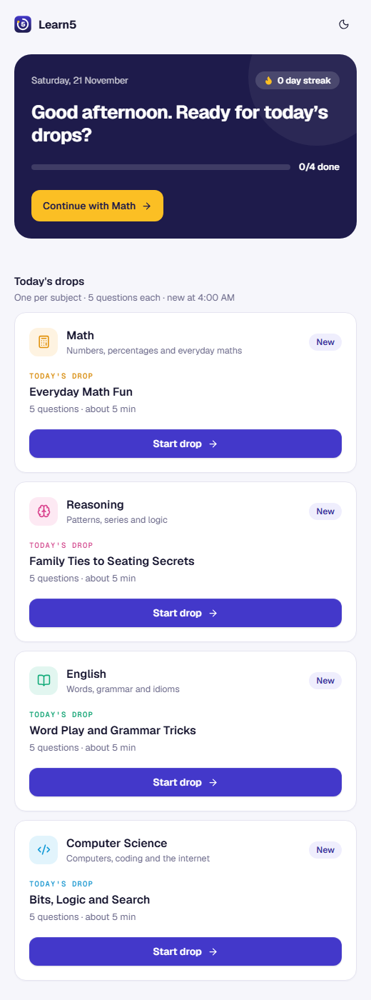
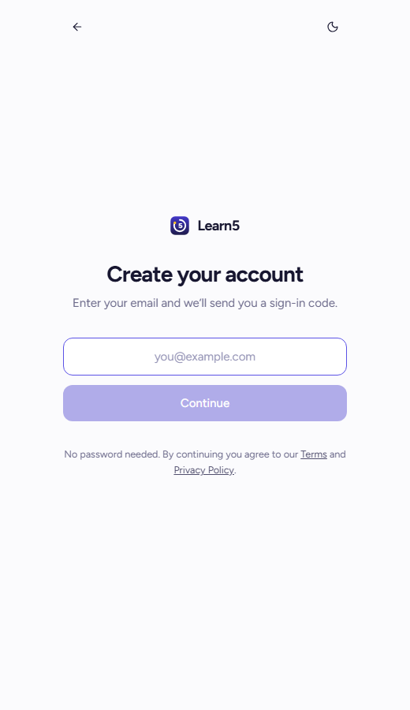
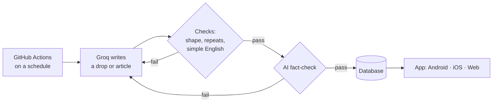
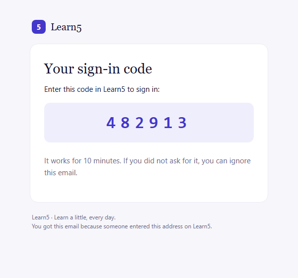

<div align="center">


# Learn5

**Learn a little, every day.**

Short daily quizzes in Math, Reasoning, English and Computer Science —
five minutes a day, with a clear explanation after every answer.

[](https://priyanshusingh.co.in)
[](https://docs.expo.dev/)
[](https://www.typescriptlang.org/)


Made by **[Priyanshu Singh](https://priyanshusingh.co.in)** — [priyanshusingh.co.in](https://priyanshusingh.co.in)

</div>

<div align="center">
  
  &nbsp;
  
  &nbsp;
  
</div>

## Contents

1. [What Learn5 is](#what-learn5-is)
2. [Quick start](#quick-start)
3. [How a day works](#how-a-day-works)
4. [Settings (`.env.local`)](#settings-envlocal)
5. [How content is made](#how-content-is-made)
6. [Emails](#emails)
7. [Project layout](#project-layout)
8. [Commands](#commands)
9. [Deploying](#deploying)
10. [Before launch](#before-launch)
11. [Author](#author)

## What Learn5 is

A small daily habit app. Every morning at **4 AM**:

- each of the four subjects gets **one new drop** — 5 questions that go from easy to hard;
- there is **one short article** to read, on a different subject each day.

Every answer explains the _why_. Wrong answers go to **Review** so you can try them again, and
fact cards are saved as **Flashcards**. Points, levels, streaks and badges keep you coming back.

It is one Expo codebase that runs as an **Android app**, an **iOS app** and a **website**, in
**light and dark mode**.

| You get           | In short                                                       |
| ----------------- | -------------------------------------------------------------- |
| **Daily drops**   | 1 per subject per day · 5 questions · 1 easy, 2 medium, 2 hard |
| **Daily read**    | 1 article a day in simple English · 2–5 minutes                |
| **Review**        | Replay the questions you got wrong until you get them right    |
| **Flashcards**    | "Did you know?" facts you collected                            |
| **Progress**      | Points, levels, streaks and badges, synced across your devices |
| **Sign-in**       | Email + 6-digit code. No password                              |
| **Works offline** | Opens instantly from a saved copy                              |
| **Reminders**     | An optional daily notification on phones                       |

## Quick start

You need **Node.js 24** and **npm**.

```bash
git clone git@github.com:priyanshuBS/learn5.git
cd learn5
npm install
cp .env.example .env.local     # fill in the values — see "Settings" below
npm run db:migrate             # create the database tables
npm run generate-drops         # write today's and tomorrow's questions
npm run generate-articles      # write today's article
npx expo start --clear         # press w for the website, or scan the QR code with Expo Go
```

> No `RESEND_API_KEY` yet? In development the sign-in code is printed in the terminal instead
> of being emailed.

## How a day works

| Time (India) | What happens                                             |
| ------------ | -------------------------------------------------------- |
| **4:00 PM**  | Tomorrow's four drops are written in advance             |
| **4:00 AM**  | The four drops open, and today's article is published    |
| **Any time** | Play a drop in about 5 minutes, read the article, review |

The article's subject changes every day:

```
Math  →  Reasoning  →  English  →  Computer Science  →  Math …
```

Times, subjects and the rotation are set in [`schedule.config.json`](schedule.config.json).

## Settings (`.env.local`)

Copy [`.env.example`](.env.example) to `.env.local` and fill it in. This file is never committed.

| Setting                    | What it is for                                                       |
| -------------------------- | -------------------------------------------------------------------- |
| `DATABASE_URL`             | Your Neon Postgres database                                          |
| `AUTH_SECRET`              | A long random secret used to protect sign-in codes and sessions      |
| `RESEND_API_KEY`           | Sends the sign-in and alert emails ([Resend](https://resend.com))    |
| `EMAIL_FROM`               | The sender, e.g. `Learn5 <no-reply@your-domain.com>`                 |
| `GROQ_API_KEY`             | Writes the questions and articles ([Groq](https://console.groq.com)) |
| `GROQ_API_KEY_2`           | _Optional._ A backup key from a different Groq account               |
| `ALERT_EMAIL`              | Where problem alerts are sent                                        |
| `EXPO_PUBLIC_APP_URL`      | Your live website (the phone apps talk to its API)                   |
| `EXPO_PUBLIC_REPORT_EMAIL` | Where "Report a wrong answer" emails go                              |

> Anything starting with `EXPO_PUBLIC_` is built into the app, so never put a secret there.

## How content is made

All questions and articles are written by AI on a schedule and saved in the database. The app
fetches them, so new content appears **without an app update**.



- **Drops** — [`generate-drops.yml`](.github/workflows/generate-drops.yml) runs at 4:00 PM
  (tomorrow) and 4:00 AM (back-up). Each drop: 3 multiple choice, 1 true/false, 1 fill-in-the-blank
  or fact card. No topic repeats within 30 days, no question within 60.
- **Article** — [`generate-articles.yml`](.github/workflows/generate-articles.yml) runs at 4:00 AM
  (back-up 5:00 AM). 300–800 words, short sentences, fact-checked.
- **Cost** — a normal day is about **10 Groq calls** (each drop and the article: one write + one
  fact-check). The client reads Groq's rate-limit headers and waits for the reset instead of
  sending calls that would be rejected, asks only for the tokens it needs, and **repairs** a
  rejected draft instead of rewriting it. Every run ends with a line like
  `Groq: 10 call(s), 0 retried, 31,000 tokens`. If the main key runs out, the backup key takes over.
- **Rules** for the AI and for people writing content: [`CONTENT_GUIDE.md`](CONTENT_GUIDE.md).

## Emails

Learn5 sends two kinds of email, both in one design that matches the app
([`src/server/email.ts`](src/server/email.ts)):

| Email            | Sent to       | When                                                          |
| ---------------- | ------------- | ------------------------------------------------------------- |
| **Sign-in code** | The user      | When they sign in or sign up (the code works for 10 minutes)  |
| **Alert**        | `ALERT_EMAIL` | A Groq key ran out, content was not written, or a job crashed |

**To change the alert address**, update `ALERT_EMAIL` in **both** places:

1. `.env.local` — for runs on your computer;
2. GitHub → your repo → **Settings → Secrets and variables → Actions** — for the daily jobs.

<div align="center">
  
</div>

## Project layout

```
app/                   Screens and API routes (every file is a page)
  (tabs)/              Today, Read, Review, Flashcards, Progress, subject pages
  api/                 Sign-in, content, articles, progress, account
src/
  components/          Buttons, cards, rows, icons…
  features/            App logic: sign-in, content, progress sync, streaks, badges
  lib/                 Shared helpers (schema.ts describes all content)
  server/              Server-only code: database, sign-in, emails
scripts/               Content generators, checks and database migrations
content/               Subjects (categories.json) and offline sample content
schedule.config.json   When drops and articles open, and the article rotation
```

**Privacy and security** — only hashes of sign-in codes and sessions are stored, sign-in codes
are rate-limited, and deleting an account removes all of its data.

## Commands

| Command                     | What it does                                   |
| --------------------------- | ---------------------------------------------- |
| `npx expo start --clear`    | Run the app (press `w` for the website)        |
| `npm run db:migrate`        | Create or update the database tables           |
| `npm run generate-drops`    | Write any missing drops for today and tomorrow |
| `npm run generate-articles` | Write today's article                          |
| `npm run cleanup`           | Delete expired sign-in codes and sessions      |
| `npm test`                  | Run the tests                                  |
| `npm run typecheck`         | Check types                                    |
| `npm run lint`              | Check code style                               |

The generators also accept `--date=YYYY-MM-DD`, `--category=<subject>` and `--dry-run`.

Before every commit:

```bash
npm run typecheck && npm run lint && npm test
```

## Deploying

**Website and API** — [EAS Hosting](https://docs.expo.dev/eas/hosting/introduction/):

```bash
npx expo export --platform web
npx eas-cli@latest deploy --prod
```

Add the server secrets (`DATABASE_URL`, `AUTH_SECRET`, `RESEND_API_KEY`, `EMAIL_FROM`) to the EAS
`production` environment with `npx eas-cli@latest env:create`.

**Phone apps** — [EAS Build](https://docs.expo.dev/build/introduction/):

```bash
npx eas-cli@latest build -p android --profile preview   # a test APK
npx eas-cli@latest build --profile production           # store builds
npx eas-cli@latest submit                               # send to the stores
```

**Daily jobs** — add these GitHub Actions secrets: `DATABASE_URL`, `GROQ_API_KEY`,
`RESEND_API_KEY`, `EMAIL_FROM`, `ALERT_EMAIL`.

## Before launch

- [ ] GitHub Actions secrets added
- [ ] Website and API deployed (`eas deploy --prod`) on your own domain
- [ ] `EXPO_PUBLIC_APP_URL` points at that domain
- [ ] The support inbox (`EXPO_PUBLIC_REPORT_EMAIL`) receives email
- [ ] Privacy and Terms pages reviewed
- [ ] Store listings ready: screenshots, description, privacy policy link

## Author

<table>
  <tr>
    <td>
      <strong>Priyanshu Singh</strong><br />
      Designed and built Learn5.<br /><br />
      🌐 Portfolio — <a href="https://priyanshusingh.co.in"><strong>priyanshusingh.co.in</strong></a><br />
      💻 GitHub — <a href="https://github.com/priyanshuBS">@priyanshuBS</a>
    </td>
  </tr>
</table>

<div align="center">
<sub>Learn5 · made by <a href="https://priyanshusingh.co.in">Priyanshu Singh</a></sub>
</div>
