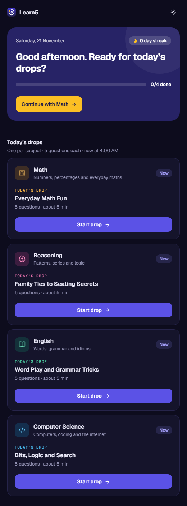
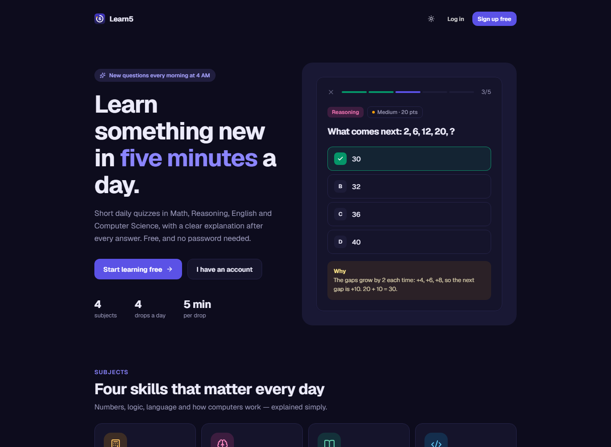
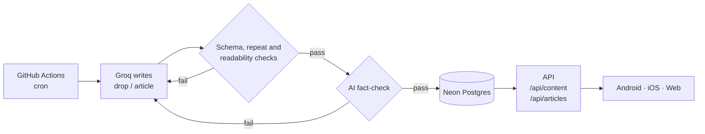

<div align="center">


# Learn5

**Daily learning, five minutes at a time.**

Math · Reasoning · English · Computer Science

[](https://docs.expo.dev/)
[](https://reactnative.dev/)
[](https://www.typescriptlang.org/)
[](https://neon.tech/)
[](https://groq.com/)


Made by **[Priyanshu Singh](https://priyanshusingh.co.in)** · [priyanshusingh.co.in](https://priyanshusingh.co.in)

</div>

---

Learn5 is a micro-learning app that builds a daily habit. **Every morning at 4 AM** each of the
four subjects gets **one fresh 5-question drop** that climbs from easy to hard, and there is
**one short, easy-to-read article**, on a different subject each day. Every answer comes with a
plain-English explanation, so you learn something even when you get it wrong.

One Expo codebase ships as an **Android app**, an **iOS app** and a **website**.

<div align="center">
  
  &nbsp;&nbsp;
  
</div>

<br />

<div align="center">
  
</div>

## Contents

- [How a day works](#how-a-day-works)
- [Features](#features)
- [Tech stack](#tech-stack)
- [Getting started](#getting-started)
- [Configuration](#configuration)
- [Content pipeline](#content-pipeline)
- [Project structure](#project-structure)
- [Scripts](#scripts)
- [Deployment](#deployment)
- [Launch checklist](#launch-checklist)
- [Author](#author)

## How a day works

| Time (IST)   | What happens                                                                         |
| ------------ | ------------------------------------------------------------------------------------ |
| **16:00**    | The generator writes **tomorrow's** four drops in advance, so they are ready on time |
| **04:00**    | All four drops open: Math, Reasoning, English and Computer Science                   |
| **04:00**    | Today's article is written and published (a back-up run follows at 05:00)            |
| **Any time** | Play each drop in about 5 minutes, read the article, review mistakes                 |

The daily article rotates through the subjects:

```
Math  →  Reasoning  →  English  →  Computer Science  →  Math  → …
```

Change the times, subjects or rotation in [`schedule.config.json`](schedule.config.json).

## Features

| Feature             | Details                                                                                                            |
| ------------------- | ------------------------------------------------------------------------------------------------------------------ |
| 🎯 **Daily drops**  | One drop per subject per day, 5 questions on a difficulty ladder (1 easy, 2 medium, 2 hard)                        |
| 📖 **Daily read**   | One 2–5 minute article a day in simple English, with key points and "words to know"                                |
| 💡 **Explanations** | Every answer explains the "why"; fact cards collect into a Flashcards deck                                         |
| 🔁 **Review**       | Replay wrong answers until you get them right                                                                      |
| 🔥 **Progress**     | Points, levels, streaks and badges, synced to your account across devices                                          |
| 🔐 **Accounts**     | Passwordless sign-in with a 6-digit email code; one-tap account deletion                                           |
| 📶 **Offline**      | Opens instantly from a local copy and keeps working offline                                                        |
| 🔔 **Reminders**    | Optional daily notification on phones                                                                              |
| 🌗 **Design**       | "Deep Indigo" design: rich indigo, gold for streaks and points, a colour per subject; Light, Dark and System modes |

## Tech stack

| Layer          | Technology                                                                                                      |
| -------------- | --------------------------------------------------------------------------------------------------------------- |
| **App**        | Expo SDK 58, React Native, Expo Router, NativeWind (Tailwind), Reanimated, Zustand                              |
| **Design**     | "Deep Indigo": indigo main colour, gold accents, soft subject colours; ink-violet dark mode; Geist + Geist Mono |
| **API**        | Expo Router API routes, hosted on EAS Hosting                                                                   |
| **Database**   | Neon (serverless Postgres)                                                                                      |
| **AI content** | Groq (`openai/gpt-oss-120b`), run on a schedule by GitHub Actions                                               |
| **Email**      | Resend (sign-in codes and owner alerts)                                                                         |
| **Validation** | Zod schemas shared by the app, the server and the scripts                                                       |
| **Tests**      | Jest (`jest-expo`)                                                                                              |

## Getting started

**Requirements:** Node.js 24 LTS and npm.

```bash
git clone git@github.com:priyanshuBS/learn5.git
cd learn5
npm install                 # install dependencies
cp .env.example .env.local  # then fill in the values (see Configuration)
npm run db:migrate          # create or update the database tables
npm start                   # press w for the website, or scan the QR code with Expo Go
```

To fill an empty database with today's and tomorrow's content:

```bash
npm run generate-drops      # 4 drops for today + 4 for tomorrow
npm run generate-articles   # today's article
```

> In development without `RESEND_API_KEY`, sign-in codes are printed in the terminal instead of
> being emailed.

## Configuration

All settings live in `.env.local` (git-ignored; template: [`.env.example`](.env.example)).

| Variable                   | Used by         | Purpose                                                         |
| -------------------------- | --------------- | --------------------------------------------------------------- |
| `DATABASE_URL`             | server, scripts | Neon Postgres connection string                                 |
| `AUTH_SECRET`              | server          | Random secret used to hash sign-in codes and session tokens     |
| `RESEND_API_KEY`           | server, scripts | Sends sign-in codes and alert emails                            |
| `EMAIL_FROM`               | server, scripts | Sender address on a verified Resend domain                      |
| `GROQ_API_KEY`             | scripts         | Groq key for the content generators                             |
| `GROQ_API_KEY_2`           | scripts         | _Optional._ Fallback key; must be from a different Groq account |
| `GROQ_MODEL`               | scripts         | _Optional._ Model name (default `openai/gpt-oss-120b`)          |
| `ALERT_EMAIL`              | scripts         | Where problem alerts are emailed                                |
| `EXPO_PUBLIC_APP_URL`      | app             | Live website; production phone builds call its API              |
| `EXPO_PUBLIC_REPORT_EMAIL` | app             | Where "Report wrong answer" emails go                           |

> `EXPO_PUBLIC_*` values are bundled into the app, so they must never contain secrets.

## Content pipeline

All learning content lives in the database and reaches the app through the API, so new content
appears without an app update.



**Drops**

- `.github/workflows/generate-drops.yml` runs at **16:00 IST** (tomorrow's drops) and **04:00 IST**
  (back-up). Existing drops are skipped, so every run is safe to repeat.
- 5 items per drop: 3 multiple choice, 1 true/false, 1 fill-in-the-blank or fact card.
- Each question comes from a different area of its subject, and the areas rotate every day
  (`CATEGORY_AREAS` in [`scripts/lib/prompt.ts`](scripts/lib/prompt.ts)).
- No repeated topics within 30 days or questions within 60 days. A drop is only served after it opens.

**Articles**

- `.github/workflows/generate-articles.yml` runs at **04:00 IST**, with a 05:00 back-up.
- One article a day on the subject chosen by the rotation; the AI picks a topic not covered in the
  last 90 days and writes 300–800 words.
- Checked for shape, simple English (no sentence over 25 words) and facts.

**Budget and alerts**

- A normal day is **4 drops (20 questions) + 1 article**, about 10 Groq requests.
- When `GROQ_API_KEY` hits its limit, the generators switch to `GROQ_API_KEY_2` if one is set.
- Problems (key limits, content not written, crashes) are emailed to `ALERT_EMAIL`, at most once
  per run.

Writing rules for people and for the AI are in [`CONTENT_GUIDE.md`](CONTENT_GUIDE.md).

## Project structure

```
app/                    Screens and API routes (Expo Router: every file is a route)
  (tabs)/               Home, Read, Review, Flashcards, Progress and subject pages
  api/                  auth, content, articles, progress, account
src/
  components/           UI building blocks (Card, Button, CategoryCard, Icon3D, …)
  features/             App logic: auth, content, articles, progress sync, badges, streaks
  lib/                  Shared helpers; schema.ts is the single source of truth for content
  server/               Server-only code: database, auth, drops, articles, email
scripts/                Generators, validators, migrations (sql/) and AI prompts (lib/)
content/                Subjects (categories.json) and seed content for offline use
schedule.config.json    Drop and article times, and the article rotation
```

**Progress sync.** Results, fixed mistakes and answer reports are stored per user through
`POST /api/progress/sync`. The device keeps a local copy and sends pending changes on the next
sync; points are recalculated on the server.

**Security.** Only hashes of sign-in codes and session tokens are stored. Sign-in codes are
rate-limited (1 per minute and 5 per hour per email, 20 per hour per network). Deleting an
account removes all of the user's data.

## Scripts

| Command                     | Description                                          |
| --------------------------- | ---------------------------------------------------- |
| `npm start`                 | Start the dev server (app and website)               |
| `npm run web`               | Start the dev server and open the website            |
| `npm run db:migrate`        | Create or update the database tables                 |
| `npm run generate-drops`    | Write missing drops for today and tomorrow           |
| `npm run generate-articles` | Write today's article                                |
| `npm run validate-content`  | Validate the files in `content/`                     |
| `npm run build-index`       | Rebuild `content/index.json`                         |
| `npm run bundle-content`    | Pack the newest content into the app for offline use |
| `npm run seed-drops`        | Copy the files in `content/` into the database       |
| `npm run cleanup`           | Delete expired sign-in codes and sessions            |
| `npm test`                  | Run the test suite                                   |
| `npm run typecheck`         | Type-check the project                               |
| `npm run lint`              | Lint the project                                     |
| `npm run format`            | Format the project with Prettier                     |

Generator options: `--date=YYYY-MM-DD`, `--category=<id>` (for articles: write this subject
instead of the scheduled one), `--dry-run`.

Before every commit:

```bash
npm run typecheck && npm run lint && npm test
```

## Deployment

**Website and API** (EAS Hosting; `app.json` uses `"web": { "output": "server" }`):

```bash
npx expo export --platform web       # build dist/ (EXPO_PUBLIC_* values are baked in)
npx eas-cli@latest deploy --prod     # publish to production
```

Server secrets (`DATABASE_URL`, `AUTH_SECRET`, `RESEND_API_KEY`, `EMAIL_FROM`) live in the EAS
`production` environment (`npx eas-cli@latest env:create`).

**Phone apps** (EAS Build):

```bash
npx eas-cli@latest build -p android --profile preview      # installable test APK
npx eas-cli@latest build --profile production              # store builds
npx eas-cli@latest submit                                  # upload to the stores
```

**Scheduled jobs** need these GitHub Actions secrets (Settings → Secrets and variables →
Actions): `DATABASE_URL`, `GROQ_API_KEY`, `RESEND_API_KEY`, `EMAIL_FROM` and `ALERT_EMAIL`.

## Launch checklist

- [ ] GitHub Actions secrets set (see [Deployment](#deployment))
- [ ] Latest website and API deployed with `eas deploy --prod`
- [ ] Custom domain pointed at the deployment; `EXPO_PUBLIC_APP_URL` updated in `.env.local` and `eas.json`
- [ ] Support inbox (`EXPO_PUBLIC_REPORT_EMAIL`) receives email
- [ ] Legal pages (`/privacy`, `/terms`) reviewed
- [ ] Store listings: screenshots, description, privacy policy URL and data-safety form

## Author

<table>
  <tr>
    <td>
      <strong>Priyanshu Singh</strong><br />
      Designed and built Learn5.<br />
      🌐 <a href="https://priyanshusingh.co.in">priyanshusingh.co.in</a> ·
      🐙 <a href="https://github.com/priyanshuBS">@priyanshuBS</a>
    </td>
  </tr>
</table>

<div align="center">
<sub>Made with care by <a href="https://priyanshusingh.co.in">Priyanshu Singh</a>.</sub>
</div>
