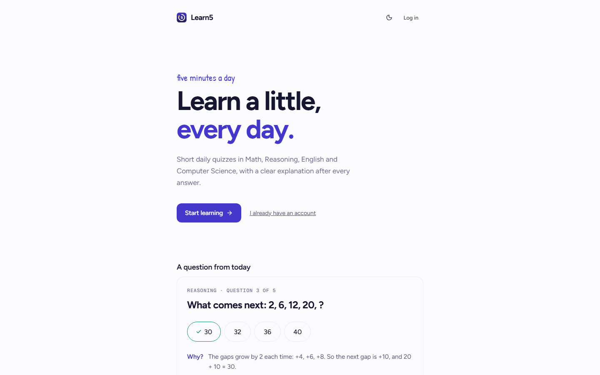
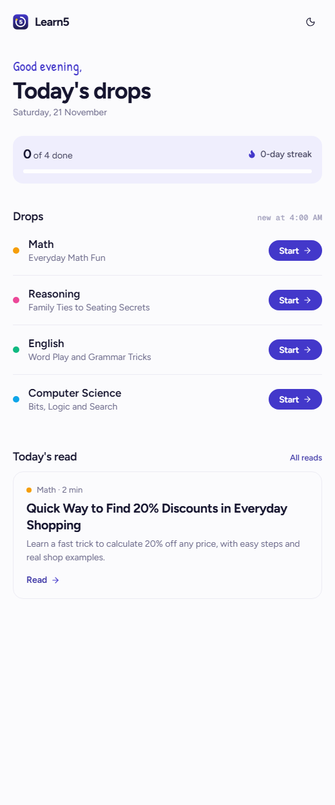
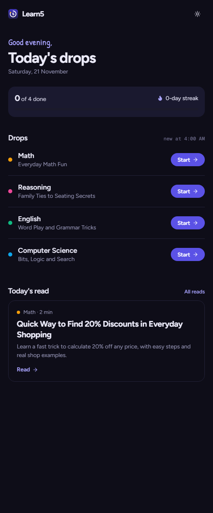

<div align="center">


# Learn5

Short daily quizzes in Math, Reasoning, English and Computer Science.<br />
Five minutes a day, with a clear explanation after every answer.

[Website](https://learn5.expo.app) ·
[Android app](https://expo.dev/accounts/priyanshu69/projects/learn5/builds/5f43439b-8288-4e2b-b37d-809a5574e50a) ·
[Author](https://priyanshusingh.co.in)

</div>

<p align="center"><strong>Website</strong></p>
<p align="center">
  
</p>

<p align="center"><strong>App</strong></p>
<p align="center">
  
  &nbsp;&nbsp;
  
</p>

## Overview

Every morning at 4 AM, Learn5 publishes:

- **Four drops** — one per subject, five questions each, from easy to hard.
- **One article** — a short read in simple English; the subject changes every day.

Wrong answers can be replayed in **Review**, facts are saved as **Flashcards**, and points,
streaks, levels and badges track progress across devices. Sign-in is passwordless (an email
code). The same codebase runs on Android, iOS and the web, in light and dark mode.

All content is written by AI on a schedule, checked in code and by a second AI fact-check,
then stored in the database. New content reaches the app without an app update.

## Tech stack

| Area    | Tools                                                       |
| ------- | ----------------------------------------------------------- |
| App     | Expo SDK 58, React Native, Expo Router, NativeWind, Zustand |
| Backend | Expo Router API routes on EAS Hosting, Neon Postgres        |
| Content | Groq (`openai/gpt-oss-120b`) via scheduled GitHub Actions   |
| Email   | Resend                                                      |
| Quality | TypeScript, Zod, Jest, ESLint, Prettier                     |

## Getting started

Requires Node.js 24 and npm.

```bash
git clone git@github.com:priyanshuBS/learn5.git
cd learn5
npm install
cp .env.example .env.local      # then fill in the values below
npm run db:migrate              # create the database tables
npm run generate-drops          # today's and tomorrow's questions
npm run generate-articles       # today's article
npx expo start --clear          # press w for the web, or scan the QR code
```

Without `RESEND_API_KEY`, sign-in codes are printed in the terminal during development.

## Configuration

Settings live in `.env.local` (never committed).

| Variable                   | Purpose                                           |
| -------------------------- | ------------------------------------------------- |
| `DATABASE_URL`             | Neon Postgres connection string                   |
| `AUTH_SECRET`              | Long random secret for sign-in codes and sessions |
| `RESEND_API_KEY`           | Sends sign-in and alert emails                    |
| `EMAIL_FROM`               | Sender address on a domain verified in Resend     |
| `GROQ_API_KEY`             | Writes the questions and articles                 |
| `GROQ_API_KEY_2`           | Optional backup key from a different Groq account |
| `ALERT_EMAIL`              | Receives alerts when a content job has a problem  |
| `EXPO_PUBLIC_APP_URL`      | Public website URL; the mobile apps call its API  |
| `EXPO_PUBLIC_REPORT_EMAIL` | Receives "report a wrong answer" emails           |

Variables starting with `EXPO_PUBLIC_` are built into the app and must not contain secrets.

## Content schedule

| Time (IST) | Job                                               | Workflow                                                           |
| ---------- | ------------------------------------------------- | ------------------------------------------------------------------ |
| 16:00      | Write tomorrow's four drops                       | [`generate-drops.yml`](.github/workflows/generate-drops.yml)       |
| 04:00      | Drops open; a back-up run fills anything missing  | [`generate-drops.yml`](.github/workflows/generate-drops.yml)       |
| 04:00      | Write and publish today's article (back-up 05:00) | [`generate-articles.yml`](.github/workflows/generate-articles.yml) |

- The article rotates Math → Reasoning → English → Computer Science.
- A normal day uses about 10 Groq calls. The client follows Groq's rate-limit headers, so it
  waits instead of sending calls that would be rejected, and it repairs rejected drafts rather
  than rewriting them.
- Times, subjects and the rotation are set in [`schedule.config.json`](schedule.config.json).
  Writing rules are in [`CONTENT_GUIDE.md`](CONTENT_GUIDE.md).

## Project structure

```
app/                Screens and API routes (Expo Router)
src/components/     UI components
src/features/       App logic: auth, content, progress, streaks, badges
src/lib/            Shared helpers; schema.ts defines all content
src/server/         Server-only code: database, auth, email
scripts/            Content generators, checks and database migrations
content/            Subjects and offline sample content
```

## Commands

| Command                     | Description                                |
| --------------------------- | ------------------------------------------ |
| `npx expo start --clear`    | Start the app                              |
| `npm run db:migrate`        | Create or update database tables           |
| `npm run generate-drops`    | Write missing drops for today and tomorrow |
| `npm run generate-articles` | Write today's article                      |
| `npm test`                  | Run tests                                  |
| `npm run typecheck`         | Type-check                                 |
| `npm run lint`              | Lint                                       |

## Deployment

**Website and API**

```bash
npx expo export --platform web
npx eas-cli@latest deploy --prod
```

Server secrets (`DATABASE_URL`, `AUTH_SECRET`, `RESEND_API_KEY`, `EMAIL_FROM`) are stored in
the EAS `production` environment.

**Mobile apps**

```bash
npx eas-cli@latest build -p android --profile preview   # installable APK
npx eas-cli@latest build --profile production           # store builds
npx eas-cli@latest submit                               # submit to the stores
```

**Scheduled jobs** need these GitHub Actions secrets: `DATABASE_URL`, `GROQ_API_KEY`,
`RESEND_API_KEY`, `EMAIL_FROM` and `ALERT_EMAIL`.

## Privacy and security

Only an email address and learning progress are stored. Sign-in codes and sessions are saved
as hashes, sign-in requests are rate-limited, and users can delete their account and all of
its data from the app.

## Author

Designed and built by **Priyanshu Singh**.

[priyanshusingh.co.in](https://priyanshusingh.co.in) · [GitHub @priyanshuBS](https://github.com/priyanshuBS)
